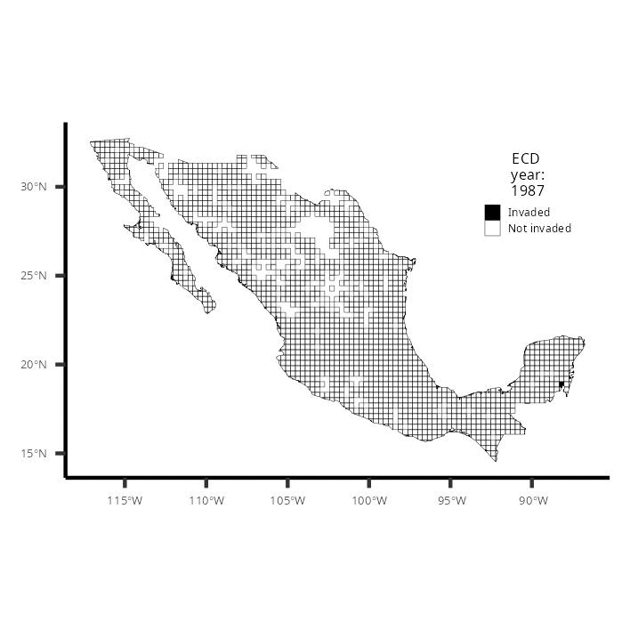

::: columns
::: column
](https://inaturalist-open-data.s3.amazonaws.com/photos/256616785/original.jpg){fig-align="center" width="350"}
:::

::: column
](https://static.inaturalist.org/photos/61919353/large.jpeg){fig-align="center" width="350"}
:::
:::

\

Las invasiones biológicas son uno de los principales conductores de la pérdida de biodivesidad. En este proyecto desarrollamos un método y proponemos un esquema para dar seguimiento y entender invasiones biológicas a grandes escala espaciales y temporales. Nuestro método para dar seguimiento a la invasión lo desarrollamos con registros públicos que comparten usuarios en plataformas masivas de ciencia ciudadana ([eBirds](https://ebird.org/home) e [iNatulista](https://www.inaturalist.org/)). Nuestro esquema para entender el proceso de invasión asocia los resultados de nuestro método con variables ambientales de escala global y de acceso libre. Esta evaluación permite entender la dinámica temporal de la invasión y si existen condiciones ambientales que las fomentan o limitan. También plantea un manejo estratégico para invasiones biológicas a partir de entender información de acceso abierto y reduciendo costos.

Para el proyecto utilizamos como modelo la invasión de dos especies de aves en México: el Estornino Pinto (*Sturnus Vulgaris*; FIg. 1) la Paloma de Collar Turca (*Streptopelia decaocto*; FIg. 2). Ambas especies son nativas en Europa y el este de Asia e invadieron México en distintos en el siglo veinte (S. XX). Además, las dos especies se asocian a ambientes antropizados, siendo particularmente abundantes en zonas productivas/agrícolas, donde ocasionan pérdidas millonarias al alimentarse. Que sus poblaciones y sus territorios crezcan implica la perdida de biodiversidad y un reto añadido al campo para lograr un buen rendimiento de los cultivos. Por ello, su monitoreo y manejo es un reto del cambio global que la [Unión por la Conservación de la Naturaleza](https://www.iucn.org/our-work/topic/invasive-alien-species) (IUCN, por sus siglas en inglés) y la [Plataforma Intergubernamental para la Biodiversidad y los Servicios Ecosistémicos](https://www.ipbes.net/invasive-alien-species-assessment) (IPBES, por sus siglas en inglés) lo señalan como un tema prioritario.

El método considera un territorio (México) segmentado en gradillas. Luego, con los registros de ciencia ciudadana de cada especie evaluamos cada elemento de la gradilla respecto a cuando fue invadido y cuántos vecinos invadidos tenía cuando ocurrió.

\

::: columns
::: column
{fig-align="center" width="350"}
:::

::: column
{fig-align="center" width="350"}
:::
:::

\

También acompañamos nuestro método desarrollando herramientas para evaluar si la expansión de la invasión se explica por el azar: con una tasa de crecimiento aleatoria o una fija obtenida a partir de la tasa observada en los registros de ciencia ciudadana.

\

{fig-align="center" width="350"}

\

Esta información permite ajustar un modelo binomial que permite un valor sobre que tan probable es que un elemento de la gradilla sea invadido (Fig. 6). Finalmente, esta probabilidad de invasión la asociamos con variables climáticas como la temperatura y la precipitación para entender si existen condiciones que favorecen o limitan la invasión. En nuestras especies modelo hallamos que al estornino se limita a áreas frías y secas del país. A la paloma len importa poco y su expansión va tan acelerado que quizá esté cerca de invadir casi todo el país.

\

{fig-align="center" width="600"}

\

El método para realizar el seguimiento de especies invasoras con ciencia ciudadana lo ofrecemos a través de dos funciones que programé en el lenguaje R. Tanto las funciones como un tutorial del esquema de trabajo los ofrecemos abiertamente en mi repositorio de de [Github](#0). Esperamos que esta propuesta ofrezca información estratégica y puntual para dar seguimiento a la invasión de especies a escalas espacio-temporales medianas y grandes.

\

------------------------------------------------------------------------

\

*Mi participación en este proyecto fue como coordinador y colaborador en el [laboratorio de Ecología Funcional, del Instituto de Investigaciones en Ecosistemas de la UNAM](https://www.iies.unam.mx/laboratorios/ecologia-funcional/), como parte del proyecto PAPIT de Especies Invasoras. Mi participación involucró su concepción, coordinación, desarrolló de código en R, colecta y visualización de datos, análisis, interpretación de resultados, y la redacción del reporte.*

\

::: text-secondary
Sus resultados se publicaron en la revista [Anthropocene](https://www.sciencedirect.com/science/article/pii/S2213305423000322) en junio de 2023. Lo puedes descargar [aquí](https://drive.google.com/file/d/1x7luyleXDjC0DwMi-ltY7w7YQMqd0WFc/view?usp=drive_link).

**Cita**: Ceja-Madrigal, A., Pacheco-Muñoz, R., Navarro-Sigüenza, A.G., Rodríguez, P., Jiménez-Cruz, M., Schondube, J.E., 2023. Factors affecting invasion process of a megadiverse country by two exotic bird species. Anthropocene 43, 100399. <https://doi.org/10.1016/j.ancene.2023.100399>
:::
