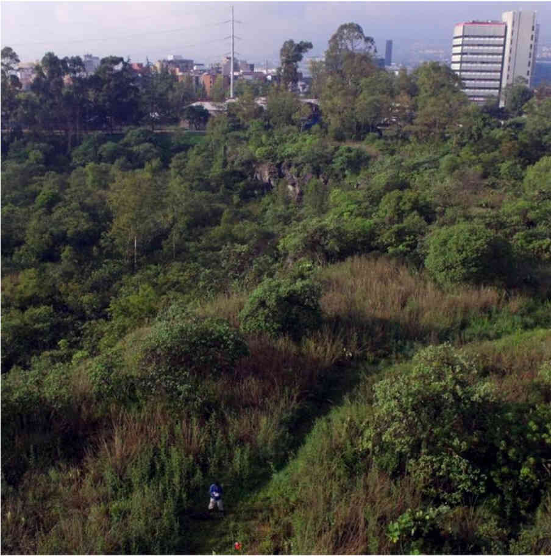
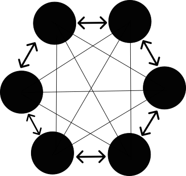

{fig-align="center" width="400"}

\
Las aves migratorias del continente americano se reproducen en la regiones templadas al norte del continente y en invierno migran a la región tropical de México, y de países en Centroamérica y Sudamérica. Lamentablemente la gran mayoría de las aves migratorias tienen poblaciones en declive desde hace más de 50 años. El cambio de uso de suelo y el cambio climático son sus principales amenazas.

Las ciudades pueden albergar una biodiversidad considerable. Por ello, es crucial entender que organismos aprovechan las ciudades y cuáles son las características urbanas que los limitan y fomentan. Algunas aves migratorias invernan en ciudades mexicanas, siendo las áreas verdes lo que más aprovechan. Este proyecto se enfocó en entender el papel que juegan las áreas verdes para las aves migratorias en una mega ciudad como la CDMX.

Para evaluarlo elegimos y visitamos distintas áreas verdes del Pedregal de San Ángel. Integrarlas requirió la coordinación con 8 instituciones públicas, privadas y de organizaciones civiles. Luego, en cada área verde realizamos censos de aves y medimos sus características espaciales, de vegetación y de cobertura de uso de suelo. La vegetación la caracterizamos generando mapas de alta resolución a través de vuelos de *dron*. La cobertura de uso de suelo adentro y alrededor del área la obtuvimos desarrollando un modelo de *Machine learning* ([*xgboost*](https://www.nvidia.com/en-us/glossary/data-science/xgboost/)), que clasificó imágenes satelitales [Landsat 8](https://www.usgs.gov/landsat-missions/landsat-8) (Fig. 1). Las características espaciales como el tamaño del área y la distancia que había entre ellas las obtuvimos calculándolas con Sistemas de Información Geográfica. Finalmente, las asociaciones entre los censos de aves y las características que medimos de las áreas verdes las evaluamos con Modelos Lineales Generalizados.

```{=html}
<!DOCTYPE html>
<html>
<head>
  <title>Before and After Image Slider</title>
  <style>
    body {
      margin: 0;
      padding: 0;
    }

    .container {
      position: relative;
      width: 70%;
      height: 0px;
      padding-bottom: 79.142%;
      border: 1px solid white;
    }

    .img {
      position: absolute;
      top: 0;
      left: 0;
      width: 100%;
      height: 100%;
      background-size: cover;
    }

    .background-img {
      background-image: url('images/RPM2022a3a.png');
    }

    .foreground-img {
      background-image: url('images/RPM2022a3b.png');
      width: 50%;
    }

    @mixin center() {
      display: flex;
      justify-content: center;
      align-items: center;
    }

    .slider {
      position: absolute;
      -webkit-appearance: none;
      appearance: none;
      width: 100%;
      height: 100%;
      background: rgba(242, 242, 242, 0.3);
      outline: none;
      margin: 0;
      transition: all 0.2s;
      @include center;
    }

    .slider:hover {
      background: rgba(242, 242, 242, 0.1);
    }

    .slider::-webkit-slider-thumb {
      -webkit-appearance: none;
      appearance: none;
      width: 6px;
      height: 600px;
      background: white;
      cursor: pointer;
    }

    .slider-button {
      $size: 30px;
      pointer-events: none;
      position: absolute;
      width: $size;
      height: $size;
      border-radius: 50%;
      background-color: white;
      left: calc(50% - 18px);
      top: calc(50% - 18px);
      @include center;

      @mixin arrow-helper() {
        content: '';
        padding: 3px;
        display: inline-block;
        border: solid #5D5D5D;
        border-width: 0 2px 2px 0;
      }

      &:after {
        @include arrow-helper();
        transform: rotate(-45deg);
      }

      &:before {
        @include arrow-helper();
        transform: rotate(135deg);
      }
    }
  </style>
</head>
<body>
  <div class='container'>
    <div class='img background-img'></div>
    <div class='img foreground-img'></div>
    <input type="range" min="1" max="100" value="50" class="slider" name='slider' id="slider">
    <div class='slider-button'></div>
  </div>

  <script src="https://code.jquery.com/jquery-3.6.0.min.js"></script>
  <script>
    $(document).ready(function () {
      $("#slider").on("input change", function (e) {
        const sliderPos = e.target.value;
        // Update the width of the foreground image
        $('.foreground-img').css('width', `${sliderPos}%`);
        // Update the position of the slider button
        $('.slider-button').css('left', `calc(${sliderPos}% - 18px)`);
      });
    });
  </script>
</body>
</html>
```
::: text-secondary
Figura 1. Haz click en la imagen interactiva y desliza la barra en dirección horizontal. Este panel muestra parte de nuestra área de estudio para ejemplificar la clasificación de coberturas de uso de suelo que realizamos en la CDMX. Cercano al centro se puede ver Ciudad Universitaria. La clasificación la hicimos utilizando nuestro modelo de Machine learning xgboost. Al modelo lo entrenamos para clasificar imágenes satelitales Landsat 8. Para fines didácticos usé una imagen satelital de *google maps* y no corresponde a la imagen **Landsat 8** que el modelo clasificó pero la imagen digitalizada si corresponde a la capa clasificada por nuestro modelo xgboost de cobertura usos de suelo.
:::

\

Con nuestra evaluación descubrimos que las áreas verdes pueden albergar una biodiversidad considerable de aves migratorias invernantes, al representar el 25% de la diversidad de aves de invierno en la CDMX. La principal características de las áreas verdes asociadas a las aves migratorias son los árboles urbanos y son cruciales. Entre más había, las especies de aves migratorias incrementaban. La ubicación y el tamaño de las áreas verdes no importó, ya no hubo distinción entre las especies que encontramos.

\

[![Figura 2. Asociación positiva de la riqueza (número de especies) y abundancia (individuos) de aves migratorias con las características de los árboles dentro de las áreas verdes. El panel superior muestra la relación entre la riqueza de especies de aves migratorias y la densidad de árboles que había en cada área verde. El panel inferior muestra la relación entre la abundancia de aves migratorias y la proporción de cobertura arbórea. Las líneas en ambas figuras representan los valores estimados dados por su respectivo modelos lineales generalizados. El ave posada en el panel inferior es una perlita gris azulada (Polioptila caerulea), una especie que se encuentra con frecuencia en las áreas verdes. Tomado de Pacheco-Muñoz et. al., (2022).](images/RPM2022a2_web.jpg){fig-align="center" width="350"}](https://linkinghub.elsevier.com/retrieve/pii/S1618866722001571)

\

Esto indica que incluso mega ciudades como la CDMX pueden contribuir con hábitat para aves migratorias a través de sus áreas verdes. Un enfoque que las fomente se debe de centrar en aumentar y conservar los árboles que contienen. Además, la falta de impacto de las características espaciales es una gran noticia debido a la limitación del espacio para áreas verdes en la ciudad (Fig. 3 y Fig. 4). ¡Áreas verdes pequeñas y aisladas pueden enriquecerse con árboles!, lo cual es fantástico para las aves migratorias y los urbanitas.

\

::: columns
::: column
{fig-align="center" width="422"}
:::

::: column
) del eje vertical indica que tan similares son las especies entre dos áreas y el eje horizontal es la distancia en metros que hay entre esas áreas. La ausencia de un patrón indica que la distancia entre ellas no implica que tengan especies distintas. Tomado de Pacheco-Muñoz (2022).](images/RPM2022a4b.png){fig-align="center" width="413"}
:::
:::

\

---

\

*Este proyecto lo realicé como parte de mi proyecto de posgrado en el [laboratorio de Ecología Funcional, del Instituto de Investigaciones en Ecosistemas de la UNAM](https://www.iies.unam.mx/laboratorios/ecologia-funcional/).* *Mi participación involucró su concepción, coordinación, administración de fondos, colecta de datos, análisis, interpretación de resultados y la redacción del reporte*.

::: text-secondary
Sus resultados se publicaron en la revista [Urban Forestry & Urban Greening](https://linkinghub.elsevier.com/retrieve/pii/S1618866722001571) en junio de 2022. Lo puedes descargar [aquí](https://drive.google.com/file/d/1CmXslpbxTO_OZSRyGPzg21lk7pzTmJ73/view?usp=drive_link).

**Cita**: Pacheco-Muñoz, R., Aguilar-Gómez, M.Á., Schondube, J.E., 2022. Overwintering in a megacity: Urban green areas and migratory birds in Mexico City. Urban Forestry & Urban Greening 73, 127614. <https://doi.org/10.1016/j.ufug.2022.127614>
:::
