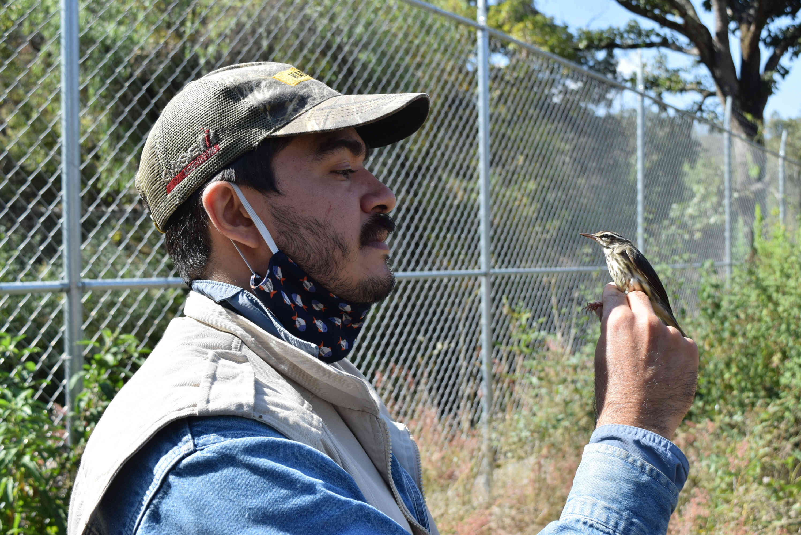
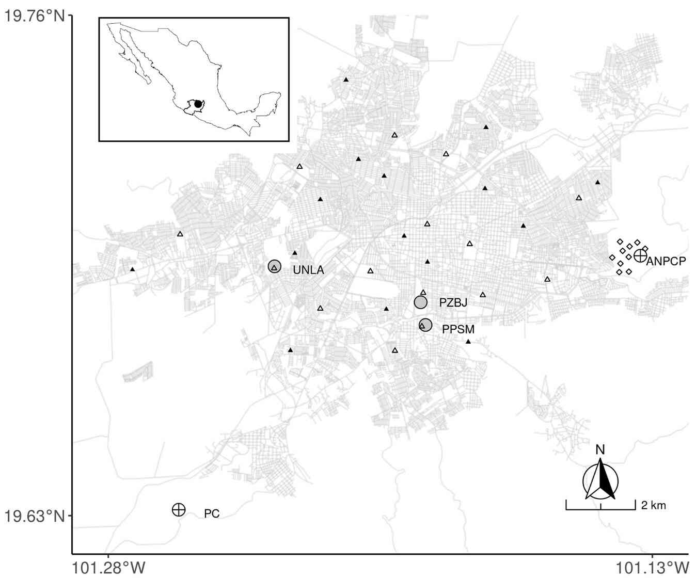

{fig-align="center" width="500"}

\

En este proyecto evaluamos si las áreas verdes de Morelia son buenos hábitats de invierno para aves migratorias. Lo iniciamos en 2019 y ha continuado por 3 inviernos. Para el proyecto generamos el primer monitoreo de aves urbanas de invierno del país con el propósito de capturarlas, evaluar su condicón corporal y posteriormente liberarlas. Las estaciones de monitoreo de aves las establecimos en áreas verdes de Morelia, pertenecientes a instituciones gubernamentales y privadas como CONAGUA, Ooapas, el zoólogico Benito Juárez, la Secretaría de Medio Ambiente de Michoacán, y la Universidad Latina de América, con quienes colaboramos y coordinamos para ello (Fig. 1).

\

{fig-align="center" width="500"}

\

Cada año en el continente americano miles de [aves migratorias](https://nationalzoo.si.edu/migratory-birds/news/conceptos-basicos-sobre-las-aves-migratorias-neotropicales) que se reproducen en las regiones templadas al norte del continente (Estados Unidos y Canadá) migran hacia los trópicos en donde invernan en distintos ecosistemas, incluyendo nuestras ciudades. Las poblaciones de estas especies llevan más de 50 años en declive, primariamente por el cambio de uso de suelo de sus hábitats silvestres a uno de actividades humanas.

La llegada de estas aves en algunas ciudades mexicanas representa al menos el 25% de las especies de todas las que hay en la ciudad, siendo particularmente abundantes cuando hay buen arbolado. Sin embargo, que lleguen en grandes números no necesariamente indica que las áreas verdes son un hábitat de buena calidad. Incluso hay casos en los que los organismos perciben caractrísticas idoneas sin notar otros factores que lleven a la muerte a sus poblaciones (*ej. depredadores invasores o contaminantes*). Para lograr un manejo adecuado de la fauna urbana es crucial evaluar si las ciudades contribuyen de positiva o negativamente en el ciclo de vida de los organismos que las habitan, como en el caso de las aves migratorias.

La evaluación de las áreas verdes como hábitat la hicimos utilizando a dos especies de aves como modelo y descubrimos que les son de buena calidad (Fig. 2 y 3). Lo hicimos tras contrastar la condición corporal (índice de masa escalada) de sus poblaciones que viven dentro y fuera de la ciudad (Fig. 4). También caracterizamos las áreas verdes y al compararlas con áreas silvestres notamos que los árboles urbanos son más grandes y complejos. Esto indica que un manejo del ecosistema urbano enfocado a fomentar aves migratorias es factible y positivo tanto para este grupo de aves como para los ciudadanos. Los mismos elementos que fomentan aves migratorias tienen un efecto positivo en la salud de los urbanitas y los procesos de la ciudad, por lo que mi perspectiva plantea un ganar-ganar en el manejo urbano.

\

::: columns
::: column
](https://inaturalist-open-data.s3.amazonaws.com/photos/122471439/original.jpg){fig-align="center" width="344"}
:::

::: column
{fig-align="center" width="336"}
:::
:::

{fig-align="center" width="680"}

\

---

\

*Este proyecto lo realicé como parte de mi proyecto de posgrado en el [laboratorio de Ecología Funcional, del Instituo de Investigaciones en Ecosistemas de la UNAM](https://www.iies.unam.mx/laboratorios/ecologia-funcional/).* *Mi participación involucró su concepción, coordinación, obtención y administración de fondos, capacitación de recursos humanos, colecta y visualización de datos, análisis, interpretación de resultados y la redacción del reporte*.

::: text-secondary
Sus resultados se publicaron en la revista [Frontiers in Ecology and Evolution](10.3389/fevo.2021.779507) en enero de 2022. Lo puedes descargar [aquí](https://drive.google.com/file/d/1ljREn87gblj3ZhPxm9jarSoe_U6BE4Om/view?usp=drive_link).

**Cita**: Pacheco-Muñoz, R., Ceja-Madrigal, A., Pérez-Negrón, E., Ortiz-Asbun, A.K., Schondube, J.E., 2022. Wintering Town: Individual Quality of Migratory Warblers Using Green Urban Areas in a Neotropical City. Front. Ecol. Evol. 9, 779507. <https://doi.org/10.3389/fevo.2021.779507>
:::
