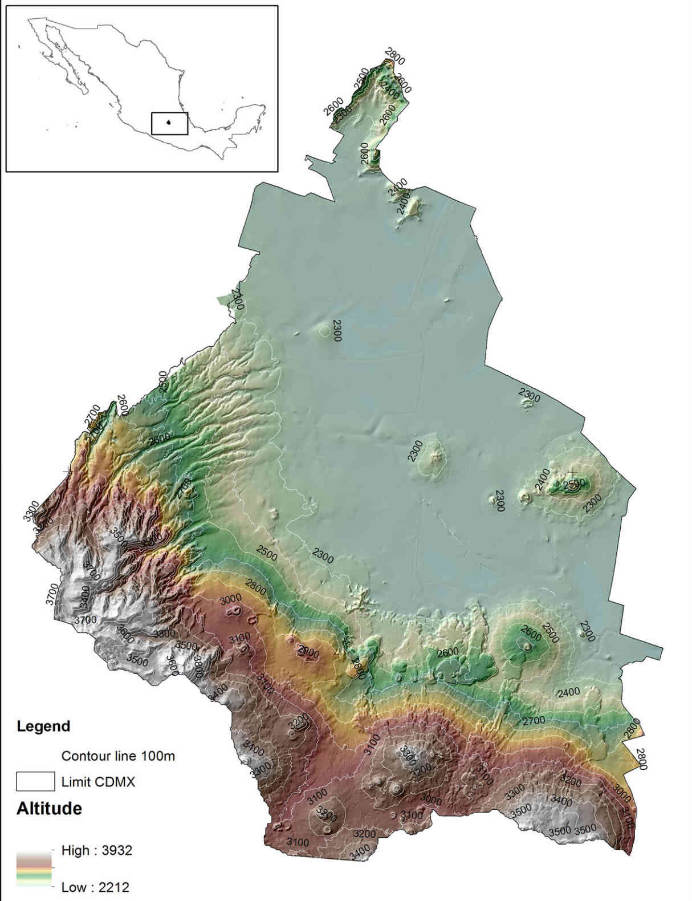
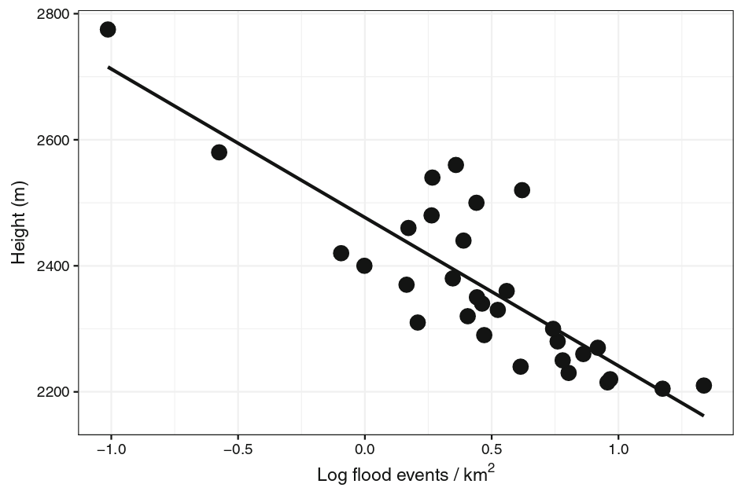
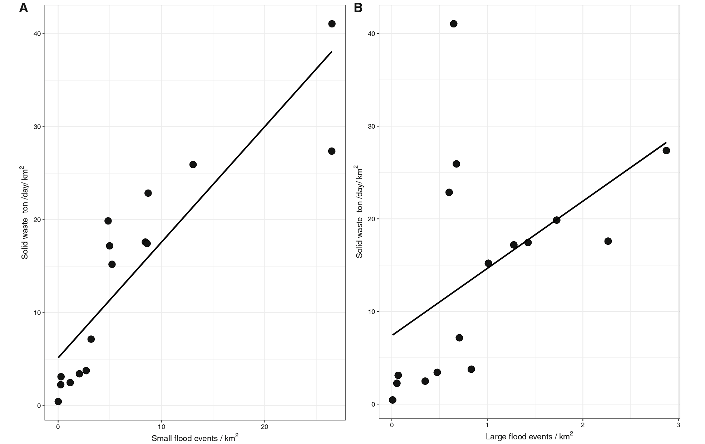
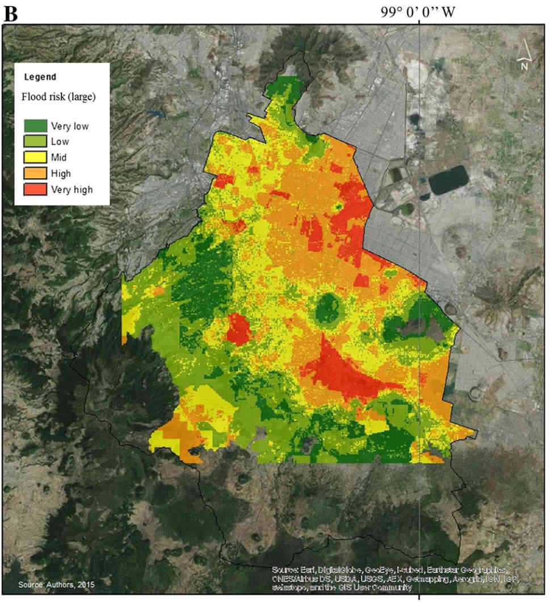

{fig-align="center" width="400"}

\

Las inundaciones en la CDMX son algo frecuente y esperado cada temporada de lluvias, y lleva ocurriendo, sin exagerar, cientos de años. Esto es en parte porque la ciudad se asentó en lo que era el antiguo lago de Texcoco pero se dice que nuestros desechos sólidos también contribuyen a los anegamientos. En este proyecto investigamos cómo influyen los desechos sólidos y la topografía en las inundaciones urbanas de la Ciudad de México.

El estudio lo llevamos a cabo usando datos públicos, principalmente de fuentes gubernamentales. Con estos datos generamos un modelo que consideraba variables geomorfológicas y de uso de suelo con el propósito de evaluar su riesgo de inundación. Luego evaluamos con modelos lineales generalizados la asociación entre la frecuencia de inundaciones pequeñas y de gran tamaño con la altitud y la producción de basura en donde ocurrían. También evaluamos que papel tenía subsidencia del suelo (que tanto se hunde) con las inundaciones con la ecuación de Michaelis-Menten.

Los modelos revelaron que más de la mitad de la ciudad corre el riesgo de inundaciones pequeñas, y una cuarta parte enfrenta el peligro de inundaciones más grandes. También descubrimos que las áreas con altitudes más bajas y tasas de subsidencia más rápidas son más susceptibles a inundaciones futuras (Fig. 1). Además, encontramos que la gestión adecuada de desechos sólidos puede ayudar a mitigar las inundaciones más pequeñas, ya que están fuertemente asociadas (Fig. 2; A). Por otro lado, nuestro modelo indicó que los urbanitas con niveles de marginación más elevados son más vulnerables a estos fenómenos.

\

{fig-align="center" width="500"}

\

[{fig-align="center" width="500"}](http://link.springer.com/10.1007/s13280-018-1023-1)

\

Las inundaciones urbanas en la Ciudad de México son un problema multifacético. Nuestro estudio resalta que las áreas naturales, como humedales y reservas ecológicas, juegan un papel crucial al reducir la vulnerabilidad a las inundaciones. También señala la posibilidad de un manejo urbano focalizado, principalmente en áreas donde la población sea más vulnerable.

\

{fig-align="center" width="500"}

\

------------------------------------------------------------------------

\

*Este proyecto lo realicé como coordinador de proyectos en el [laboratorio de Restauración Ecológica del Instituto de Biología de la UNAM](https://www.restauracionecologica.org/), con fondos del [Climate and Development Knowledge Network (CDKN).](https://cdkn.org/)* *Mi participación involucró su coordinación desde su planteamiento, colecta y visualización de datos, análisis, interpretación de resultados y la redacción de su reporte*.

\

::: text-secondary
Sus resultados se publicaron en la revista [Ambio](http://link.springer.com/10.1007/s13280-018-1023-1) el 24 de febrero de 2018 y lo puedes descargar [aquí](https://drive.google.com/file/d/1cuVCBIqx4IRRP-BVCzjwiCVdgD9Of4_H/view?usp=drive_link).

**Cita**: Zambrano, L., **Pacheco-Muñoz, R**., Fernández, T., 2018. Influence of solid waste and topography on urban floods: The case of Mexico City. Ambio 47, 771--780. <https://doi.org/10.1007/s13280-018-1023-1>
:::
