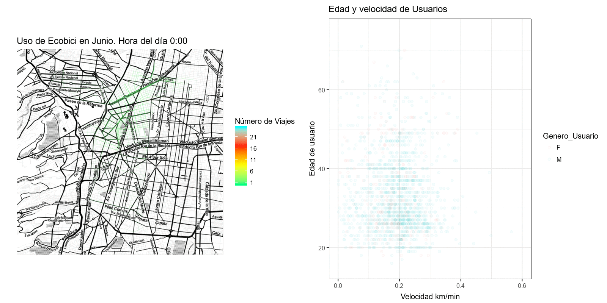

```{r , echo=F,results='hide',message=FALSE, warning=FALSE}
library(knitr)
library(kableExtra)
library(tidyverse)

options(knitr.table.format = "html")

dat_md = read_csv('/home/pacheco/Documents/R/Ecobici/2017-06.csv')

est_md = read_csv('/home/pacheco/Documents/R/Ecobici/estaciones.csv')
```

{fig-align="center" width="1199"}

La CDMX cuenta con una red de transporte público ciclista Ecobici. Esta red ha hecho más ameno el traslado por la ciudad por la actividad física, la experiencia y su rapidez en distancias cortas y medianas, relativo al coche u otras alternativas públicas. Además, los distintos gobiernos han mantenido un esfuerzo por ofertar la información de sus servicios y la demografía de sus usuarios de forma transparente en su [portal](https://www.ecobici.cdmx.gob.mx/es) y API. Esto permite explorar y entender el servicio para reconocer oportunidades estratégicas en sus procesos.

El programa Ecobici inicio en 2010 y sus servicios se ido extendiendo. En su primer año había 10,000 usuarios por día y en un lustro se triplicó a 30,000 usuarios al día. Al momento de esta nota, el servicio cuenta con 452 estaciones y cubre 32 km2.

En este proyecto evalué el uso de las bicis en junio de 2017 y evalué las rutas más concurridas y las velocidades a las que transitan a lo largo del día desglosado por la edad y el sexo de los usuarios. Luego generé [una app](https://datapach.shinyapps.io/rutas_ecobici_jun2017/) para cada quien explore esta información como quiera.

## Los datos de las bicis

Trabajar solo con el mes de junio de 2017 permite ejemplificar un marco de trabajo dinámico y extrapolable. También economiza en recursos computacionales.

En la siguiente tabla muestro los datos que constituyen la información que oferta el gobierno sobre Ecobici. De izquierda a derecha los datos proporcionan el sexo (Femenino o masculino), la edad, el número de bici, la estación en la que inician su recorrido y donde lo terminan, así como la hora y el día en que la dejan. El total de viajes que muestran estas ocho variables en junio son de 853,651.

```{r , echo=F,message=FALSE, warning=FALSE}
kable(head(dat_md,20), caption = "Datos de viajes de ecobici en junio de 2017") %>%

   kable_styling(bootstrap_options = c("striped", "hover", "condensed", "responsive"), 

                 font_size = 8,full_width = F,position = "center")%>%

  scroll_box(width = "100%", height = "300px")
```

La localización de las estaciones se encuentra en otro tabla y la información requiere relacionarse.

```{r , echo=F,message=FALSE, warning=FALSE}
kable(head(est_md[,-c(1,3,6)],20), caption = "Informacion de estaciones de ecobici CDMX") %>%

   kable_styling(bootstrap_options = c("striped", "hover", "condensed", "responsive"), 

                 font_size = 8,full_width = F,position = "center")%>%

  scroll_box(width = "100%", height = "300px")
```

## ¿Qué rutas toman?

La información permite relacionar donde inician y terminan el servicio. Estos permite generar las rutas más probables por las cuáles transitan. No obstante, es necesario verificar que todos los datos nos sean útiles para entenderlo.

Al revisar la información me percaté de retiros y devoluciones que ocurren en la misma estación. Al ser el movimiento entre estaciones nuestro interés no los consideré. Luego, a través de la API de google maps obtuve la ruta ciclista más probable ente cada salida y cada llegada. Sin embargo, ya que este servicio solo permite solicitar 2,000 rutas cada 24 horas, solo solicité las rutas más concurridas y que acumulan el 64.41% de los viajes (535,523 viajes).

Cada viajes contiene su fecha y hora. Con la ruta proporcionada por google obtengo la ruta más probable y también me permite obtener una distancia. A través de esta información pude estimar la velocidad del viaje por edad, sexo y hora del día:

{fig-align="center"}

::: text-secondary
Figura 1. El panel de la izquierda muestra las rutas más concurridas de la ciudad a distintas horas del día. El panel de la derecha muestra en el eje horizontal la velocidad de los usuarios y en el eje vertical la edad de los usuarios. Los usuarios se muestran por sexo autodenominado (femenino en rojo y Masculono en azul) a distintas horas del día,
:::

El gif resume el resultado de nuestra evaluación de los datos ofertados por Ecobici a las distintas horas del día en en que ocurrieron los viajes. Las velocidades por las mañanas son mejores y decrecen a eso de las 11:00 am, con pocos usuarios durante la noche.

También hay más variabilidad en las velocidades entre los 20 y los 40 años y este intervalo el que más usuarios tiene. Al parecer los usuarios más veloces rondan los 30's. Es muy notorio que predomina el color azul, que denota una mayoría de usuarios del sexo masculino. Además, las rutas más usadas cruzan av. Reforma y las calles de la Condesa.

## Ecobici Shiny app

Este esquema de evaluación de rutas se puede explorar al gusto del usuario a través de la aplicación interactiva [*Shiny*](https://datapach.shinyapps.io/rutas_ecobici_jun2017/)*.* Da click para usarla (Ten un poco de paciencia si la aplicación demora en desplegarse, ya que muestra todos los viajes disponibles).

`<iframe height="1000" width="100%" frameborder="yes" src=" https://datapach.shinyapps.io/rutas_ecobici_jun2017/"`{=html} </iframe>

[Da click aquí para desplegarla en una página independiente.](https://datapach.shinyapps.io/rutas_ecobici_jun2017/).

## Conclusión

Esta herramienta permite identificar las rutas más transitadas, el perfil demográfico de los usuarios de dichas rutas, así como su dinámica a lo largo del día. Además, permite identificar y brindar atención focalizada a las bicicletas más usadas, dando un estimado de la distancia que han recorrido acotado a rutas explícitas. Así, esta herramienta puede permitir un manejo estratégico de los recursos y el servicio de ecobici.

------------------------------------------------------------------------

\

*Este proyecto lo realicé con el propósito de desarrollar mis habilidades en aplicaciones Shiny y en técnicas de análisis espacial*
