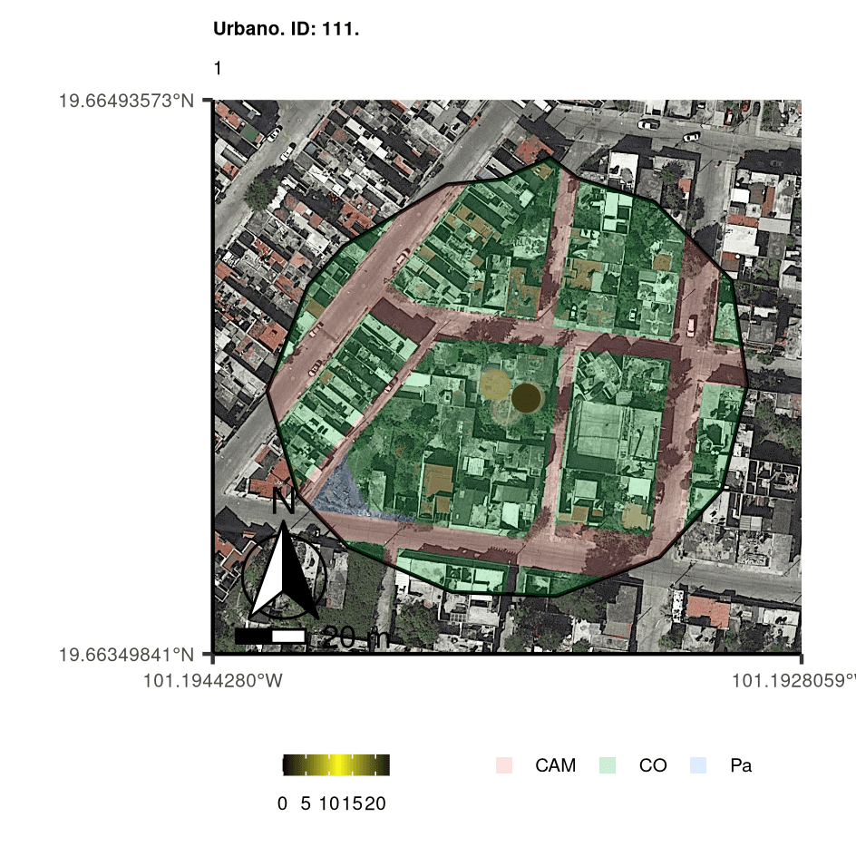
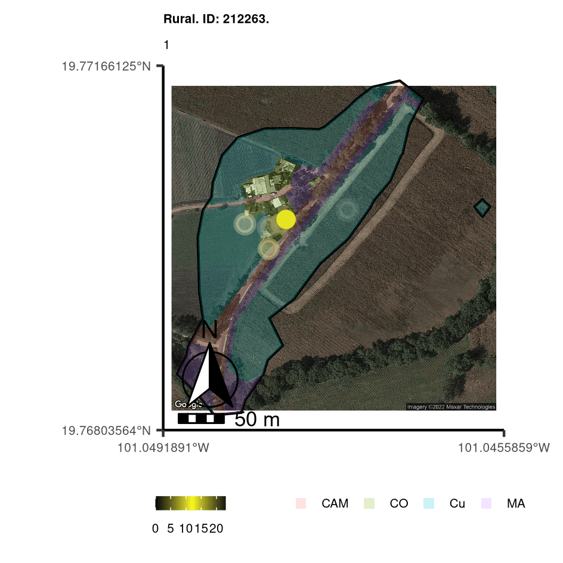
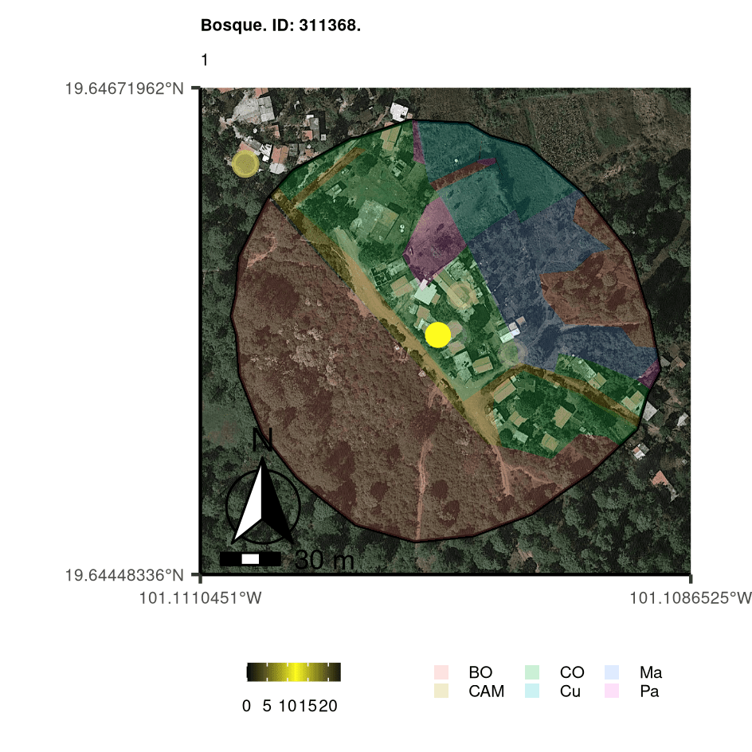

## Seguimiento de gatos por gps

En 2016, el Laboratorio de [Ecología Funcional del IIES, UNAM](https://www.iies.unam.mx/laboratorios/ecologia-funcional/?page_id=53), colocó collares GPS a varios gatos con hogar en contextos ambientales urbanos, productivos y boscosos. Los gatos usaron estos collares por varios días y cada dos minutos se generaba un registro nuevo. En el 2022 me incorporé a este proyecto para evaluar con métodos estadísticos la información espacial generada por medio de los collares y para generar visualizaciones que faciliten esta evaluación. Los resultados de este proyecto serán publicados en una revista científica y ayudarán a generar un mejor manejo de los gatos en libertad en diversos contextos ambientales.

*Este proyecto lo actualizaré y profundizaré en él cuando la publicación esté disponible.*

Las siguientes ejemplos muestran el seguimiento de algunos gatos en cada uno de los contexto ambientales que evaluamos. Los polígonos muestran el **ámbito hogareño** ([*Se entiende por ámbito hogareño (AH) el área de actividad que ocupan los animales, donde llevan a cabo todas sus funciones que permiten su supervivencia como: alimentación, descanso, reproducción, protección*](https://www.inecol.mx/inecol/index.php/es/ct-menu-item-25/ct-menu-item-27/17-ciencia-hoy/2033-que-es-el-ambito-hogareno-de-los-animales-y-como-se-puede-conocer)*)* y una clasificación del uso de suelo presente. Los movimiento diurnos y nocturnos se señalan con el cambio de color amarillo y negro, respectivamente.

Seguimiento de gato **urbano** por gps

Seguimiento de gato **productivo** por gps

{fig-align="center"}

Seguimiento de gato **boscoso** por gps

{fig-align="center"}
