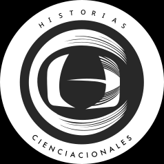

Mis actividades de **comunicación de la ciencia** las realizo de forma independiente. Generalmente a través de mi plataforma Historias Cienciacionales y como invitado en diversos medios, donde abordo un tema en específico.

\

# Historias Cienciacionales

{fig-align="center" width="200"}

[**H**istorias **C**ienciacionale](https://cienciacionales.com) es una plataforma de comunicación de la ciencia en español, dirigida al público latinoamericano. En 2014 la desarrollé y fundé juntó con dos colegas científicos y comunicadores de la ciencia: Sofía Flores y Victor Hernández. Nuestro propósito es contribuir a la difusión de la ciencia de una manera entretenida, rigurosa y sencilla.

Abordamos investigaciones cinetíficas recientes, dese la frontera de la ciencia y de distintos campos del conocimiento. Es frecuente que entrevistemos a los investigadores que protagonizan dichas investigaciones. Nuestro material lo distribuimos a través de posts en Instagram y a través de un podcast en diversas plataformas.

¡Checa una de nuestras *breves* de Instagram! 👇

```{=html}
<style>
  .instagram-container {
    display: flex;
    justify-content: space-between;
  }

  .instagram-post {
    width: calc(50% - 10px);
    margin-right: 10px;
  }

  /* The last post in the row should not have a right margin */
  .instagram-container .instagram-post:last-child {
    margin-right: 0;
  }
</style>
```

::::: instagram-container
::: instagram-post
```         
<blockquote class="instagram-media" data-instgrm-permalink="https://www.instagram.com/p/CgzKVrLukfV/?utm_source=ig_web_button_share_sheet&igshid=MzRlODBiNWFlZA==" data-instgrm-version="13"></blockquote>
```

```{=html}
<script async src="//www.instagram.com/embed.js"></script>
```
:::

::: instagram-post
<blockquote class="instagram-media" data-instgrm-permalink="https://www.instagram.com/p/CisH3AVuE3-/?utm_source=ig_web_copy_link&amp;igshid=MzRlODBiNWFlZA==" data-instgrm-version="13">

</blockquote>

```{=html}
<script async src="//www.instagram.com/embed.js"></script>
```
:::
:::::

\

## Historias cienciacionales: el podcast

Este proyecto inició en 2014 en el Instituo Mexicano de la Radio. Ahí producimos el podcast por dos años y posteriormente lo realizamos de forma independiente. Hoy día cuenta con **+200 episodios** en **cuatro temporadas**, donde hemos contado con **+250 investigadores mexicanos e internacionales**, de **+50 instituciones**.

¡Escucha nuestros episodios por [Soundcloud](https://on.soundcloud.com/dhjGxlw8rdUksX2mx3) o Spotify! 👇

<iframe style="border-radius:12px" src="https://open.spotify.com/embed/show/1M7Qlyt0MgEmd8AJtVm4ES?utm_source=generator" width="100%" height="200" frameBorder="0" allowfullscreen allow="autoplay; clipboard-write; encrypted-media; fullscreen; picture-in-picture" loading="lazy">

</iframe>

# Publicaciones relevantes en medios

- En 2020. **Nexos.** En colaboración con la Dra. Cristina Ayala. Breve revisión histórica de las consecuencias de los mega proyectos turísticos en la península de Yucatán. La nota fue de las más leídas ese año.

  - Ayala-Azcárraga, C. y **Pacheco-Muñoz**, Rodrigo. [*Desarrollar la península, perpetuar pobreza.*](https://medioambiente.nexos.com.mx/desarrollar-la-peninsula-perpetuar-pobreza/) **Nexos, *Crisis ambiental - Impactos y Deterioro,* 2020.**

\

# Presencia en medios

- **INFOBAE, 2023.** La nota explica las razones de las inundaciones en le CDMX con base en nuestra investigación al respecto.

  - [Por qué se inunda la Ciudad de México siempre que llueve.](https://www.infobae.com/mexico/2023/06/08/por-que-se-inunda-la-ciudad-de-mexico-siempre-que-llueve/)

- **La Jornada Morelos.** ***Tenga para que se entretenga**,* **2023*.*** La nota aborda nuestra investigación sobre el uso de ciencia ciudadana para el seguimiento de especies invasoras.

  - [Lo que aprendimos de dos aves que invadieron México](https://www.lajornadamorelos.mx/opinion/tenga-para-que-se-entretenga-26/?fbclid=IwAR3kHKObkiKPwogmlSI3AybZB0zYpNMo5xS54P5LXBF9D3j-_Hs_b8w4KW0)

- **EpiSTEMas. 2022.** Podcast de comunicación de la ciencia donde me entrevistan sobre mi trabajo y sobre la perspectivas con las que abordo el entendimiento de las ciudades.

  <iframe style="border-radius:6px" src="https://open.spotify.com/embed/episode/2tiTYMkoBXUQmWQqHj3tZ7?utm_source=generator" width="100%" height="200" frameBorder="0" allowfullscreen allow="autoplay; clipboard-write; encrypted-media; fullscreen; picture-in-picture" loading="lazy">

  </iframe>

- **BBC. *Futures***, **2022**. La nota habla sobre la migración de aves y su relación con la urbanización en el continente de América, a través de entrevistas a científicos que las estudiamos a lo largo de su trayecto migratorio. La nota aborda mi investigación sobre aves migratorias, donde comprobé que las ciudades pueden ofrecer hábitat de calidad a algunas especies. Este hallazgo es pionero en su campo.

  - [*The strange reason migrating birds are flocking to cities*](https://www.bbc.com/future/article/20220217-the-strange-reason-migrating-birds-are-flocking-to-cities).

- **WRADIO. *Así las cosas,* 2022.** Participé en el programa de radio matutino con una intervención acerca del daño que puede representar que los cuervos se entrenen para recoger colillas. Esto también derivó en una nota escrita:

  - [Grave que cuervos recojan colillas: Biólogo de la UNAM](https://wradio.com.mx/programa/2022/02/18/asi_las_cosas/1645207682_946982.html)

- **MVS Noticias.** *Pamela Cerdeira**,*** **2022*.*** En mi intervención ofrecí hipótesis sobre las causas de un evento de muerte masiva de tordos de cabeza amarila (*Xanthocephalus xanthocephalus*).

  - [¿Por que sucedió la muerte masiva de aves migratorias en Chihuahua?](https://mvsnoticias.com/autos-mas/2022/2/18/por-que-sucedio-la-muerte-masiva-de-aves-migratorias-en-chihuahua-543469.html)

# Mención relevante

- En 2015 realicé un video apreciativo del Axolote (*Ambystoma mexicanum*). El video lo realicé durante la etapa piloto del proyecto que planteó un refugio urbano en la Cantera Oriente de Ciudad Universitaria de la UNAM. El proyecto de refugios en la cantera aún continua realizándolo el Laboratorio de Restauración Ecológica.

<iframe width="560" height="315" src="https://www.youtube.com/embed/nT6_h2ByLi8" title="YouTube video player" frameborder="0" allow="accelerometer; autoplay; clipboard-write; encrypted-media; gyroscope; picture-in-picture; web-share" allowfullscreen>

</iframe>