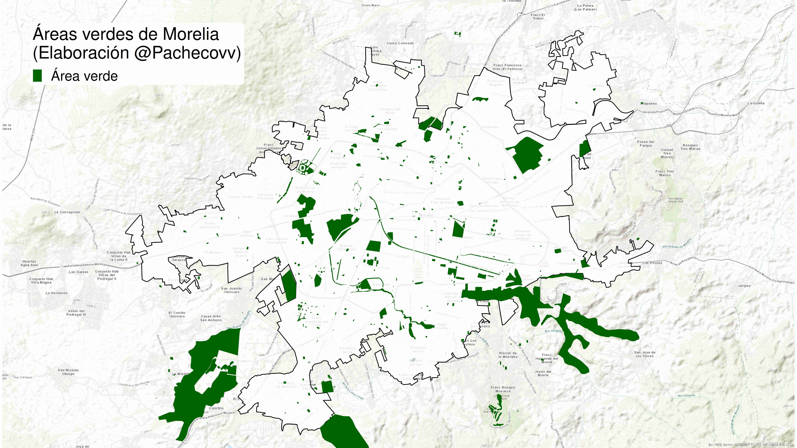
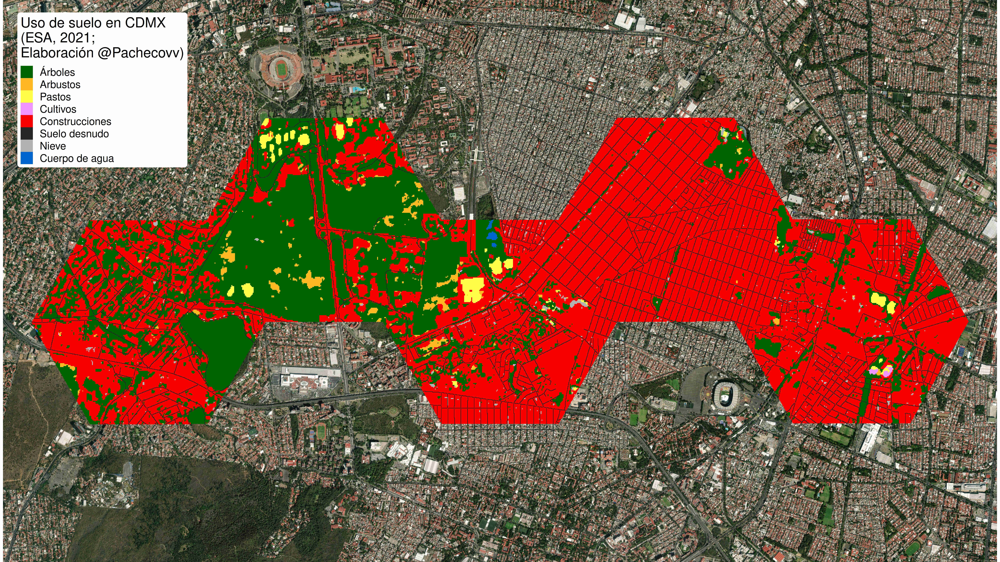
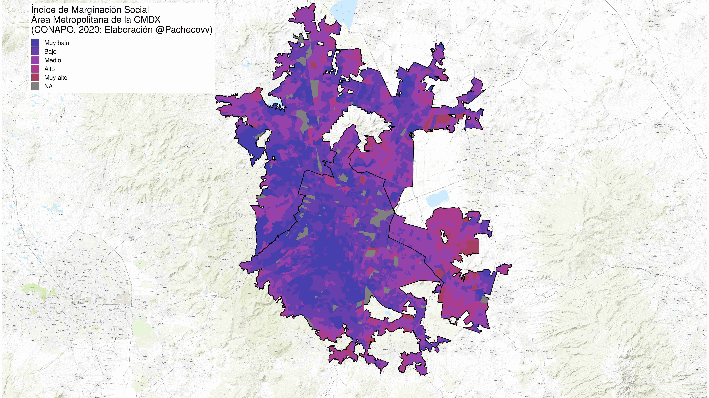
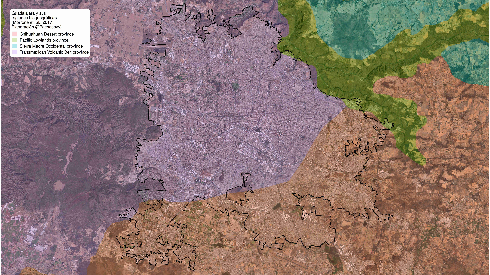

```{=html}
<!-- ============================================================
     HERO BANNER — index.qmd
     Estructura: carrusel de imágenes + overlay con nombre y botones
     ============================================================ -->

<div class="hero-container">

  <!-- Imágenes del carrusel -->
  
  
  
  

  <!-- Overlay: nombre + subtítulo + botones -->
  <div class="hero-overlay">
    <p class="hero-name">Dr. Rodrigo Pacheco Muñoz</p>
    <p class="hero-subtitle">Ecólogo Urbano · Manejo estratégico del paisaje · Científico de Datos · BI Data products</p>
    <div class="hero-buttons">
      <a href="about.html"      class="hero-btn hero-btn-primary">Acerca de mí</a>
      <a href="proyectos.html"  class="hero-btn hero-btn-outline">Proyectos</a>
    </div>
  </div>

</div>

<style>
/* ── Contenedor principal ── */
.hero-container {
  width: 100vw;
  margin-left: calc(50% - 50vw);
  position: relative;
  height: 0;
  padding-bottom: 56.25%; /* ratio 16:9 */
  overflow: hidden;
  background: #111;        /* fallback mientras cargan imágenes */
}

/* ── Imágenes del carrusel ── */
.hero-img {
  position: absolute;
  inset: 0;                /* shorthand de top/right/bottom/left: 0 */
  width: 100%;
  height: 100%;
  object-fit: cover;
  opacity: 0;
  transition: opacity 1.2s ease-in-out;
}
.hero-img.active {
  opacity: 1;
}

/* ── Overlay con degradado oscuro ── */
.hero-overlay {
  position: absolute;
  inset: 0;
  z-index: 2;
  display: flex;
  flex-direction: column;
  justify-content: center;   /* centrado vertical */
  align-items: flex-start;   /* alineado a la izquierda */
  padding: 0 6%;             /* margen lateral */
  background: linear-gradient(
    to right,
    rgba(0,0,0,0.65) 0%,
    rgba(0,0,0,0.25) 60%,
    rgba(0,0,0,0.0)  100%
  );
}

/* ── Nombre principal ── */
.hero-name {
  font-size: clamp(1.6rem, 4vw, 3rem);  /* escala con viewport */
  font-weight: 700;
  color: #ffffff;
  margin: 0 0 0.3em 0;
  text-shadow: 0 2px 8px rgba(0,0,0,0.6);
  line-height: 1.2;
}

/* ── Subtítulo / roles ── */
.hero-subtitle {
  font-size: clamp(0.85rem, 1.8vw, 1.2rem);
  color: rgba(255,255,255,0.82);
  margin: 0 0 1.6em 0;
  letter-spacing: 0.03em;
  text-shadow: 0 1px 4px rgba(0,0,0,0.5);
}

/* ── Contenedor de botones ── */
.hero-buttons {
  display: flex;
  gap: 0.8em;
  flex-wrap: wrap;           /* en móvil se apilan */
}

/* ── Botón base ── */
.hero-btn {
  display: inline-block;
  padding: 0.55em 1.6em;
  font-size: clamp(0.8rem, 1.5vw, 1rem);
  font-weight: 600;
  border-radius: 6px;
  text-decoration: none;
  transition: transform 0.15s ease, opacity 0.15s ease;
  cursor: pointer;
}
.hero-btn:hover {
  transform: translateY(-2px);
  opacity: 0.9;
  text-decoration: none;
}

/* ── Botón primario (sólido) ── */
.hero-btn-primary {
  background: #ffffff;
  color: #1a1a1a;
  border: 2px solid #ffffff;
}

/* ── Botón outline (transparente) ── */
.hero-btn-outline {
  background: transparent;
  color: #ffffff;
  border: 2px solid rgba(255,255,255,0.85);
}
.hero-btn-outline:hover {
  background: rgba(255,255,255,0.15);
  color: #ffffff;
}

/* ── Responsive ── */
@media (max-width: 768px) {
  .hero-overlay {
    align-items: center;       /* centrado en móvil */
    text-align: center;
    background: linear-gradient(
      to bottom,
      rgba(0,0,0,0.3) 0%,
      rgba(0,0,0,0.65) 100%
    );
  }
  .hero-buttons {
    justify-content: center;
  }
}
</style>

<script>
document.addEventListener('DOMContentLoaded', () => {
  const imgs = document.querySelectorAll('.hero-img');
  if (!imgs.length) return;

  let current = 0;
  imgs[0].classList.add('active');

  setInterval(() => {
    imgs[current].classList.remove('active');
    current = (current + 1) % imgs.length;
    imgs[current].classList.add('active');
  }, 6000);
});
</script>
```